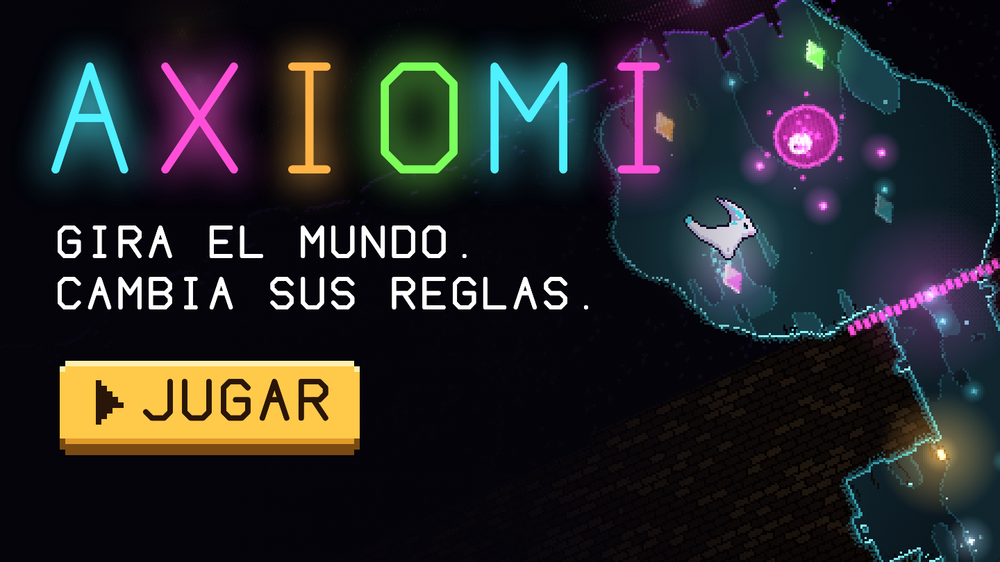

# AXIOMI

[](https://ricardious.github.io/axiomi/)

Creado por **ricardious**.

Arcade experimental en pixel art: **giras el mundo** para mover a una pequeña criatura de luz por cuevas oscuras sin fondo: pozos, túneles horizontales, cámaras y cuevas laterales. Girar el mundo cambia hacia dónde cae la gravedad; tocar un **cristal** tiñe tu luz de su color y te deja atravesar las barreras de ese color.

**Jugar:** https://ricardious.github.io/axiomi/

El juego se ve dentro de un monitor CRT retro sobre un escritorio de noche (todo dibujado con código).

## Controles

| Acción | Teclado | Ratón / táctil |
|---|---|---|
| Girar el mundo (gravedad) | `←` `→` o `A` `D` | arrastrar a los lados |
| Caminar (en RUINAS y CUBOS) | `←` `→` o `A` `D` | arrastrar y mantener |
| Saltar | `Espacio`, `↑` o `W` | toque |
| Sonido on/off | `M` | — |
| Marco de la PC on/off | `F` | — (en pantallas verticales se juega sin marco) |

## Cristales y barreras de color

Funcionan como **llave y puerta**: toca un cristal y tu luz toma su color. **Las barreras e islas de tu color se vuelven fantasma** y las atraviesas; las de los otros colores son sólidas. Cada barrera tiene su cristal justo antes, en el camino. Cada color da además un efecto:

| Color | Efecto |
|---|---|
| **CIAN** | ninguno (con él empiezas) |
| **ROSA** | salto fuerte |
| **ÁMBAR** | gastas menos luz |
| **VERDE** | el tiempo se frena |

## El Guardián

Al final de cada mundo que gira (el primero a unos 60 m, luego cada ~150 m) hay una cámara con un **Guardián** que sella la salida. No se le dispara: se le vence con el color.

- Su **coraza** tiene un color. Si lo tocas con otro, te quema luz y te rebota.
- Toca el **cristal de su color** (la flecha lo señala) y **embístelo**: atraviesas la coraza y golpeas el núcleo. Al tomar su color se asusta y se queda paralizado un momento; después retrocede despacio.
- Tras cada golpe **cambia de color** y se vuelve más rápido. Lanza **brasas** de su color; las de tu color no te hacen nada.
- Mientras peleas, **la Sombra espera** y la luz se gasta a la mitad. Al vencerlo se abre la salida, recuperas luz y la Sombra retrocede.

### Mejoras

Al vencer a un Guardián el juego se detiene y **eliges una mejora entre dos**, sorteadas al azar entre doce (`←` / `→`, o toca el lado). Se acumulan durante la partida, así que cada descenso arma una criatura distinta.

| Mejora | Efecto |
|---|---|
| **LUZ AMPLIA** | +25 de luz máxima |
| **DOBLE SALTO** | un salto más en el aire |
| **ESCUDO** | te salva de un golpe (púa, coraza o brasa) |
| **IMÁN** | recoges semillas desde más lejos |
| **LUZ LENTA** | tu luz se gasta menos |
| **SOMBRA LENTA** | la Sombra baja más lento |
| **SALTO ALTO** | saltas más alto |
| **SEMILLA RICA** | las semillas dan más luz |
| **TESORO** | las semillas valen el doble de puntos |
| **GARRA** | cada golpe al Guardián cuenta doble |
| **LÁMPARA VIVA** | las lámparas duran el doble |
| **PIEL DURA** | el Guardián te quema menos luz |

## Biomas

Cada ~70 m el pozo cambia de escenario. Siempre empiezas en las grutas, pero **el orden de los demás biomas se sortea en cada partida**: nunca sabes qué viene después. Pasas por todos antes de que alguno se repita, y nunca te toca el mismo dos veces seguidas. Solo GRUTAS y GEODA son cuevas. Los mundos de la naturaleza son **al aire libre**, y en el ABISMO ni siquiera hay suelo: cada piso es un gran espacio abierto de lado a lado, con suelo abajo y un hueco para seguir bajando, y del suelo crecen hongos, corales, árboles, pinos o paletas que sirven de plataforma. En los geométricos (ruinas y cubos) **el mundo no gira**: la gravedad queda hacia abajo y caminas y saltas, un respiro para no marearse.

En cinco biomas **la criatura se transforma** y cambia cómo te mueves:

| Bioma | Transformación | Qué cambia |
|---|---|---|
| **LAGUNA** | pez, con aletas y cola | caes despacio y **cada salto es una brazada** |
| **CIELO** | alas | **planeas** al caer y en el aire tienes un aleteo extra |
| **NIEVE** | bufanda de tu color | el suelo es hielo: **te deslizas** casi sin frenar |
| **DULCE** | una burbuja | **rebotas** en las paredes |

| Bioma | Cómo es |
|---|---|
| **GRUTAS** | túneles y cámaras de roca con hierba y raíces |
| **LAGUNA** | todo bajo el agua: caes despacio, **cada salto es una brazada** y la criatura cambia de forma, con aletas y cola de pez. Fondo marino con corales, algas y burbujas |
| **JARDÍN** | terrazas de tierra con pasto, flores, árboles frondosos, enredaderas y pétalos que caen |
| **CIELO** | cielo azul con pisos de nube, islas de nube flotando y motas blancas en el aire |
| **NIEVE** | laderas nevadas con pinos, carámbanos colgando y copos que caen |
| **DULCE** | suelo de caramelo a rayas con paletas gigantes, glaseado rosa que gotea y chispas de azúcar |
| **BOSQUE HONGO** | un bosque de hongos gigantes que sirven de plataforma, esporas y lianas |
| **GEODA** | cámaras de paredes facetadas con cristales que brotan de los muros |
| **ABISMO** | **caída libre**: no hay suelo, caes varios pisos seguidos por un vacío lleno de islas flotantes (algunas con púas, otras de color) y giras el mundo para esquivarlas. La cámara mira hacia donde caes |
| **RUINAS** | *(no gira)* templo de ladrillo: salas rectangulares, pasillos rectos, columnas rotas que hay que saltar y arcadas al fondo |
| **CUBOS** | *(no gira)* grandes salas cuadradas de losetas con bloques flotantes (algunos de color) |

## Cómo se juega

- **Sigue las chispas y la flecha**: marcan el camino.
- **Desciende** lo más hondo que puedas. El camino baja por pozos y corre por túneles hacia los lados: inclina el mundo para que la gravedad te lleve por ellos.
- **Barreras de color** cierran el paso: toca el cristal de su color para abrirlas.
- **Cuevas laterales** sin salida guardan semillas y lámparas.
- **La Sombra** cae desde arriba y acelera con la profundidad.
- **Tu luz** se gasta sin parar, más al girar. Recógela en los cristales o en las lámparas.
- **Púas** rojas: tocarlas te apaga.

## Reglas del reto

- **≤ 32 KB:** el juego completo es un único `index.html` (~28 KB), que es exactamente lo que descarga el navegador. El build falla si se pasa del límite.
- **Código propio:** JavaScript puro con Canvas 2D y Web Audio. Sin librerías, frameworks ni motores.
- **Cero assets:** el pixel art (cuevas, criatura, flora), la luz tramada, la tipografía vectorial, los efectos y la música generativa se crean con código.

## Desarrollo

```bash
npm install      # solo instala terser (minificador, en build)
npm run build    # src/ → minifica → empaqueta → index.html (y comprueba el límite de 32 KB)
```

El código fuente legible está en `src/game.js`. `index.html` en la raíz es el build que se publica en GitHub Pages; `pack.mjs` es el compresor LZ77 propio con el que se empaqueta.
